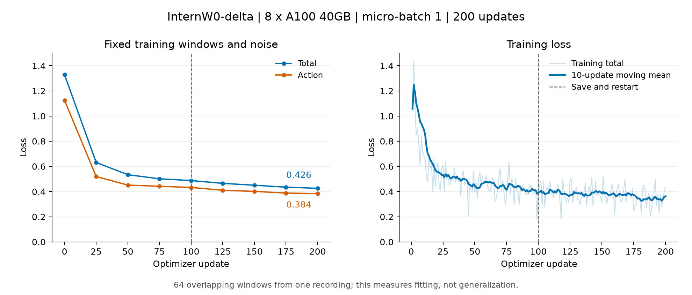

# InternW0-delta 八卡 A100 测试结果

**完整策略训练通过：完成 200 次更新，第 100 步保存后重启并恢复成功，loss 明显下降。**
当前配置的三步容量探测上限为每卡 batch=3、全局 batch=24；每卡 4 在第 3 次更新时
出现 CUDA 显存不足。这个短测边界不等于长期训练的稳定 batch 上限。

作业为 [cogact-a1008-probe-20261022-eaiacr](https://aka.ms/amlt?q=lbbrs)，
后端 ID `epic_quince_bjc5wkd8f2`，使用 `eaiws / palisades33` 的单节点
8×NVIDIA A100-SXM4-40GB。正式训练配方尚未确定。

## 测试条件

加载完整预训练策略，更新 6,211,551,888 个可训练参数；视频编码器和视觉语言模型
在线运行、冻结权重。使用 bf16、梯度检查点、AdamW、学习率 `5e-5`、梯度裁剪 `1.0`，
以及 DeepSpeed ZeRO-2（将梯度和优化器状态分摊到 8 张卡）。梯度累积为 1，无 CPU 卸载。

输入是同一真实录制片段中的 64 个不同但相互重叠的窗口，每个窗口有 32 步、80 维动作，
9 帧 384×256 三视角画布，以及当前/历史观测。按已核对的 InternW0-delta 约定，
关节使用下一帧测量得到的绝对关节值，夹爪使用当前命令；无效动作维度用掩码排除。
不输入外参。数据来自 `15/20260506_162713` 的 `[3142,3447)`，归一化也使用该片段统计。

这是小数据拟合和接口可运行性检查，没有独立验证集，不能据此推断泛化或机器人成功率。

## Batch 与显存

各档使用独立 8 进程，尝试 3 次完整的前向、反向和参数更新。以下显存均取 8 卡中的
最大值，单位为 GiB；硬件使用量每秒采样一次，可能漏掉瞬时峰值。

| 每卡 batch | 全局 batch | 结果 | PyTorch 分配峰值 | PyTorch 保留峰值 | 整卡采样峰值 | 更新秒数 |
|---:|---:|---|---:|---:|---:|---:|
| 1 | 8 | 通过 | 31.58 | 36.15 | 37.74 | 2.84 |
| 2 | 16 | 通过 | 31.59 | 36.19 | 37.76 | 3.00 |
| 3 | 24 | 通过 | 32.87 | 36.97 | 38.57 | 3.03 |
| 4 | 32 | 第 3 次更新 OOM | 34.83 | 36.83 | 38.49 | — |

OOM 行的显存是失败前记录值，不是该 batch 成功运行所需的显存。更新秒数不含首步预热，
计时覆盖前向、反向、优化器更新和必要检查，不含输入组装、结果写盘、评估和检查点上传。

200 步恢复轮使用每卡 batch=1、全局 batch=8。训练、保存及重新加载检查点期间，整卡
采样峰值为 **39.43 GiB**，说明三步探测不能覆盖全部运行阶段的显存峰值。
恢复轮去除两个进程各自首步后的平均更新耗时为 **1.370 秒**，约 **5.84 样本/秒（全局）**。
两个工作进程从启动到退出的采样时长合计约 **653 秒**，包含模型加载、评估和本地保存，
不含后续上传。容量探测与恢复轮的耗时来自独立进程，未混合平均。

[容量原始表](results/cogact_a100_20261022/capacity.csv)、
[容量测试每卡显存](results/cogact_a100_20261022/capacity_memory_by_gpu.csv)、
[200 步运行每卡硬件峰值](results/cogact_a100_20261022/training_hardware_peaks.csv)。

## Loss 与恢复

每 25 步在相同的 8 个训练窗口上，用固定的 3 组噪声评估，再跨卡取平均。
下表各分项已乘模型中的 loss 权重，初末值分别对应第 0、200 步。五项的线性拟合斜率
均为负，下降结论同时得到初末值和整个曲线的支持。

| Loss | 初始 | 第 200 步 | 下降 |
|---|---:|---:|---:|
| 总 loss | 1.327727 | 0.425981 | 67.92% |
| 动作 | 1.124757 | 0.383707 | 65.89% |
| 视频 | 0.099130 | 0.024113 | 75.68% |
| 未来变化 | 0.086454 | 0.008616 | 90.03% |
| 未来语义 | 0.017386 | 0.009544 | 45.10% |

记录包含连续的 200 步训练和 9 组固定评估。所有训练 loss、梯度范数均为有限值，
8 个进程均检测到实际参数更新。第 100 步保存模型、优化器、调度器和每卡随机状态后，
原进程退出；新进程核对配置、数据签名及文件大小，从第 100 步恢复到第 200 步。
`result.json` 的 `resume_verified` 为 `true`。

[训练 CSV](results/cogact_a100_20261022/training.csv)、
[固定评估 CSV](results/cogact_a100_20261022/evaluation.csv)、
[机器可读结果](results/cogact_a100_20261022/result.json)、
[可缩放曲线](results/cogact_a100_20261022/loss_curve.svg)。未接入 W&B。

## 本次修复与结果位置

首次训练在第 100 步直接向挂载存储写大检查点，一个优化器分片迟迟未完成，导致其他
进程触发 300 秒 NCCL 同步超时。训练本身已能运行，但首次尝试没有完成恢复验证。

修复为先在节点本地保存和恢复，工作进程全部退出后再上传，并最后发布检查点完成
标记。顺序复制到挂载存储仍遇到大文件等待，因此本次检查点归档改用 AzCopy 直传，
逐文件核对远端大小。相关代码为 [暂存脚本](../scripts/cogact_a100_probe_stage.sh)、
[直传工具](../tools/cogact_publish.py) 和 [作业入口](../scripts/cogact_a100_workload.sh)。
新增上传工具的 4 个测试通过，覆盖完成标记顺序、上传失败、凭证日志脱敏、网络重试
及已上传文件复核；shell 语法
及差异空白检查通过。
未改变模型、数据、优化器或工作进程代码；复用已完成的容量测试，在原节点重跑拟合。
原始失败记录保留，没有另行申请 GPU。

作业输出中，最终结果使用 `probe-localio-20261022/`；`probe/` 是首轮失败记录。
恢复退出码单独写入根目录的 `recovery_exit.json`。原前台包装脚本已进入 20 小时排错
保留期，并保留首轮退出码 1；平台状态不能代替恢复结果，保留期间仍占用 8 张卡。

最终归档退出码为 **0**，37 个检查点相关文件共 175,959,462,362 字节均已核对远端大小。
[归档回执](results/cogact_a100_20261022/archive_receipt.json)、
[第 100 步完成标记](results/cogact_a100_20261022/checkpoint_100_complete.json)、
[第 200 步完成标记](results/cogact_a100_20261022/checkpoint_200_complete.json) 和
[训练记录核验](results/cogact_a100_20261022/verification.json) 已保存到本仓库结果目录。

完整环境、输入及镜像恢复记录见 [实验协议](cogact_a100_probe.md)。
