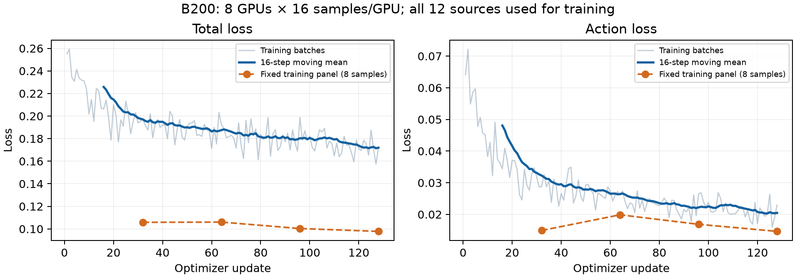

# CogACT → InternW0-Delta：B200 准备与验证

日期：2026-10-23。目标是在已分配的 8×B200 Pod 内直接运行脚本，验证
InternW0-Delta-Base 的 CogACT 关节动作微调接口。正式训练已按文末的
全局batch256、10万步方案启动，准备与短测记录保留如下。

## 已确认的边界

- Kubernetes context `oidc@msr02`，namespace `bonete05`，Pod
  `liluo-agibot-2-server-0`，container `server`；物理节点 `slc01-cl02-hgx-0061`。
- 保留 Pod、Job 和 PID 1 的 `sleep`。不用提交、删除、重建或重启资源。
- `/data/liluo/msra_process` 只读，派生文件全部写入 `/data/yuming`。
- 用户已授权在准备完成后停止原 GPU 训练进程。本次只向核对过的
  torchrun launcher PID `99473` 发送 SIGTERM，8 个 GPU worker 随后退出。
  原任务最近检查点为 `epoch=3-step=50000.ckpt`，9 个文件；完整路径与进程
  快照保存在下述准备目录的 `previous_training_stop.json` 和
  `previous_training_processes.json`，原检查点保留。

## 路径与数据口径

| 用途 | Pod 内路径 |
|---|---|
| 代码、独立虚拟环境 | `/workspace/internw0-delta-yuming-20261023`、其下 `.venv` |
| 准备日志和审计回执 | `/data/yuming/internw0-delta/preparation-20261023` |
| 权重 | `/data/yuming/internw0-delta/checkpoints` |
| 正式索引和统计 | `/data/yuming/internw0-delta/datasets/corrected12-all-20261023` |
| 文本缓存 | `/data/yuming/internw0-delta/cache/text-corrected12` |
| 训练结果 | `/data/yuming/internw0-delta/runs` |

精确清单见 `configs/data/cogact_corrected12.json`：8 份非茶任务＋4 份茶任务，
茶0930采用 `episodic_dataset_20261003_tea0930_sep24only_v1.npy`，动作目录均为
`actions_cmd_rfix_v1`。**全部用于训练，不留验证集**；先前的95/5候选统计不使用。

保留 metadata 中 good/medium 片段，逐帧取窗口（stride=1），每片段最后一帧
无法构成下一帧动作，故不作为起点。每 epoch 共 **6,893,243** 个有效窗口，
共 **30,625** 个片段、**2,632** 条不同任务指令。跨来源重叠区间为0。

### 有效数据时长（2026-10-23 补充核算）

只读核对正式 `episodes.jsonl` 和12份源数据的 `indexed_mp4/files.json`：
所选片段覆盖的视频分片均为30 FPS。按同一原始录制的帧区间取并集，
三路相机只计一次，得到 **6,918,855 个不重复帧，即64.0635小时**。
其中8份非茶任务为21.6519小时，4份茶任务为42.4116小时；共有380个
不同录制路径，切成30,625个训练片段。片段数不能直接等同于论文的完整示范条数。

不合并片段交叠时合计6,923,868帧，即64.1099小时。差额5,013帧
（约2.79分钟、0.0724%）来自同一来源内部的片段交叠；跨来源交叠仍为0。
这次只核算时长，未改变源数据、片段索引、归一化统计或每epoch的6,893,243个窗口。
上述时长不含未选用的录制部分，也不将32步重叠窗口或训练epoch重复累加。

对照InternW0-Delta论文表6，11个真机任务跨4个平台合计4,173条示范、
3,132,122帧、约29.00小时；其中AC-One为约20.03小时。
我们当前所选数据的独立时长约为论文全部真机数据的2.21倍、AC-One数据的3.20倍。
论文来源：https://arxiv.org/html/2609.31394#S5.T6 。

归一化采用官方 z-score（减均值、除标准差），按全部训练片段的有效原始值
统计，不重复统计每个窗口的32步，也不统计补齐动作。state 与 action 分别
统计；标准化值按官方实现截断到 `[-5,5]`。
数据签名：`2320fa375ded473df404986bcb388b55d50f6e9bd9e5ce5567dce19599a95e6f`。

## 接口与已完成检查

- 原始动作是无 NumPy 文件头的 float32 `[T,56]`。
- 每个窗口32步、80维，仅16个关节/夹爪通道有效；有效槽为
  `0:7,16,40:47,56`。其余维度及尾部补齐动作全部屏蔽损失。
- action：下一帧实测左右关节＋当前帧夹爪命令；state：当前实测关节＋
  实测夹爪除以120。不使用外参。全量动作审计中命令/实测关节最大差为0。
- 图像每4帧取一帧，共9帧，另有片段首帧及 t−32 历史帧。
  三相机视图输入冻结的 RynnBrain，拼图输入 Wan，拼图为384×256。
- 只读 PyAV reader 使用源 `indexed_mp4` 和已有 `.frames.npz`，检查文件大小、
  修改时间及精确帧时间戳；索引失效时报错，不重建源索引。
- 12 份各检查起点、尾部、跨500帧分片，共36个真实窗口；尺寸、有限性、
  尾部掩码、未截断动作反归一化及批次拼接均通过。证据：`dataset_check.json`。
- 11项本地测试通过；Hydra 配置解析、训练接口配置校验、JSON/CSV输出检查通过。

## 权重与运行环境

已下载 InternW0-Delta-Base、Wan VAE（图像编码/解码器）、UMT5 文本编码器及 tokenizer、
RynnBrain1.1-2B；14个文件全部通过大小和 SHA256 校验，共约31.1GB。
回执为 `weights_receipt.json` 和 `text_weights_receipt.json`。

独立环境：Python3.11，torch2.10.0+cu128，torchvision0.25.0+cu128，
transformers5.13.0，deepspeed0.19.2，PyAV16.0.1。精确依赖见准备目录
`pip-freeze.txt`。直接使用 `.venv/bin`，避免启动时重解析依赖。

## 可复用命令

以下命令在 Pod 内代码目录执行，统计输出必须为新的空目录。

```bash
.venv/bin/python tools/cogact_prepare_dataset.py \
  --manifest configs/data/cogact_corrected12.json \
  --validation-fraction 0 \
  --output /data/yuming/internw0-delta/datasets/corrected12-all-20261023

.venv/bin/python tools/cogact_check_dataset.py \
  --prepared /data/yuming/internw0-delta/datasets/corrected12-all-20261023 \
  --output /data/yuming/internw0-delta/preparation-20261023/dataset_check.json

bash scripts/cogact_b200_run.sh text
bash scripts/cogact_b200_run.sh smoke
```

脚本使用文件锁防重复启动，发现 GPU 进程就退出，不自动停止其他任务。
smoke 默认8卡、每卡batch1、bf16、ZeRO2（把优化器状态和梯度分摊到8卡）、
梯度检查点（重算中间结果以节省显存）开启、全量训练参数更新；8步后计算固定训练样本loss并保存状态。
`train` 模式的默认10epoch等值是早期候选配置；正式训练需显式传入
`task=cogact_bs256_100k`，采用文末已确认的10万步计划。

训练输出 `metrics.jsonl`（每行一条JSON记录）、长表 `metrics.csv`（每行一个step的一个指标）及
`gpu_metrics_rank_*.jsonl`，记录loss、梯度范数、吞吐、各卡峰值显存。
上述短测不连接W&B。`train_panel/*` 是固定训练样本、固定随机噪声的拟合指标，
不代表未见数据的泛化表现。

## GPU 验证状态

文本缓存2632条已生成，逐文件检查形状和有限值通过。

8卡每卡batch1短测8步通过，全部6,211,551,888个可训练参数参与训练；
策略权重严格加载通过。第8步完整保存权重与训练状态共111.06GB，耗时约108秒。
随后新进程以 `resume=auto max_steps=16 save_every=0 eval_every=16` 启动，
成功恢复模型、优化器、调度器、采样器和随机状态；数据位置恢复为
`epoch=0 batch_in_epoch=8 sample_offset=64`，继续运行至16步并正常退出。
本次延长max_steps仅检查恢复能力，保留了原8步余弦调度器的状态，不能视为
一次完整16步训练计划的等价重放；正式训练应保持原定调度计划。

每卡batch16、全局batch128的128步短测已完成：

```bash
RUN_ID=b200-bs16-128steps-20261023 bash scripts/cogact_b200_run.sh smoke \
  batch_size=16 num_workers=4 max_steps=128 save_every=0 eval_every=32
```

另以每卡batch32、全局batch256完成48步吞吐测试：

```bash
RUN_ID=b200-bs32-48steps-20261023 bash scripts/cogact_b200_run.sh smoke \
  batch_size=32 num_workers=4 max_steps=48 save_every=0 eval_every=0
```

两组均使用真实数据解码、在线冻结的VAE/VLM、bf16、ZeRO2、梯度检查点，
未使用图像或VLM特征离线缓存。统计去掉前16步，以及紧接固定样本评估的
时间间隔；其余慢步全部保留，没有额外剔除异常值。

| 每卡batch | 全局batch | 平均秒/步 | 中位数秒/步 | 全局样本/秒 | 每卡最大已分配/保留显存GiB |
|---|---|---|---|---|---|
| 16 | 128 | 1.860 | 1.507 | 68.83 | 60.81 / 75.37 |
| 32 | 256 | 2.756 | 2.690 | 92.90 | 95.68 / 115.44 |

显存为PyTorch分配器统计，保留显存包括可复用的缓存；不等同于nvidia-smi
显示的全部进程占用。batch16的慢步包括第30步22.62秒、第86/104步约5.3秒，
所以全程统计比日志中某些连续10步的80–85样本/秒更保守。
已验证batch32可运行，**没有测定最大batch或吞吐最优配置**。

batch16的前32步与后32步平均总loss为 **0.21142 → 0.17472（下降17.4%）**，
action loss为 **0.04018 → 0.02143（下降46.7%）**。
固定训练样本的总loss在第32/64/96/128步为
`0.10585 / 0.10603 / 0.10033 / 0.09781`。这些结果表明短程拟合已开始，
尚未评估机器人任务成功率。两组全部loss与梯度范数均为有限值。



完整指标、配置、退出码、日志和统计方法的结果位于
`docs/results/cogact_b200_20261023/`；`bs16/summary.json` 和 `bs32/summary.json`
包含每卡显存明细与时间统计。

## 先前10epoch预算（已由下方10万步方案替代）

- 建议每卡batch32、全局256作为当前候选；是否继续测试更大batch或改变
  梯度检查点策略，可按时间预算决定。
- 当前逐帧采样下，10epoch为269,270次更新。按batch32实测平均耗时，纯训练
  约8.59天；若每1000步保存一次、沿用约108秒的保存耗时，合计约8.9天，
  尚未计入其他等待或长期性能变化。batch16对应纯训练约11.59天。
- 当前候选学习率5e-5，AdamW，weight decay 0.01，cosine衰减。
  官方训练器默认用总更新数的5%预热；上述10epoch计划会有13,463个预热步，
  约10.3小时。总步数与预热策略应一并确认。
- 当前保存间隔候选为1000步。完整训练状态单份约98.6GB，另有轮换策略权重；
  本次权重＋训练状态共111.06GB。长训前要保留与检查点匹配的
  `normalization.json`、数据manifest和配置。

短测结束时，正式长训尚未启动。当时检查显示Pod为Running、重启次数0、
PID1仍为sleep、8张GPU无计算进程。代码与回执快照另存共享盘准备目录，
不依赖当前Pod的临时文件系统。

## 当前选定方案：全局batch256、10万步、关闭RTC

用户随后选择绝对关节角训练、不启用RTC，按更新步数控制预算。
本地配置为 `configs/task/cogact_bs256_100k.yaml`，继承已验证的CogACT数据接口：
8卡、每卡batch32、梯度累积1、`max_steps=100000`（优先于epoch设置），
学习率5e-5、AdamW（betas=0.9/0.95）、weight decay 0.01、BF16、
梯度裁剪1.0、5%预热即5000步后cosine衰减。保留ZeRO2与梯度检查点，
每进程4个数据加载worker；不加入4D蒸馏。动作仍为32步、16个有效关节/夹爪槽
映射到80维，使用现有z-score统计，全部12份数据用于训练。
每5000步保存一次权重与完整训练状态；固定训练样本loss仍每1000步评估一次。

10万步共处理2560万个窗口，约相当于当前数据的3.714遍。
按先前同batch、RTC关闭的B200短测平均2.7555秒/步，纯训练约76.54小时；
每5000步保存一次、每次约108秒，20次保存增加约0.6小时，合计约77.14小时。
该估算来自短测；加上固定训练样本评估、初始化和长期I/O波动，建议预留3.5–4天。

正式训练启用用户指定的W&B项目 `xymliu/cogact_baseline`，同时保留本地JSON/CSV。
API key只通过进程环境注入，不能写入Git、配置或启动回执；
通过 `WANDB_RUN_ID` 和 `WANDB_RESUME=allow` 将恢复训练关联到同一个W&B run。
代码已同步到Pod目录 `/workspace/internw0-delta-yuming-20261023`。

```bash
WANDB_MODE=online RUN_ID=b200-joint-bs256-100k bash scripts/cogact_b200_run.sh train \
  task=cogact_bs256_100k
```

输出为 `/data/yuming/internw0-delta/runs/cogact/b200-joint-bs256-100k`。
默认从Base权重初始化；恢复本次中断训练时用同一输出目录并加 `resume=auto`，
保持10万步的调度计划。之前的17万步RTC建议已被本方案替代。

## 正式训练启动记录

已于2026-10-23 17:27（北京时间）在现有Pod内直接启动，训练代码提交为
`8e3994138af91c63976f86411202428b283a335d`，已推送到
`starrliu/InternW0-Delta` 的 `cogact_baseline` 分支。
独立后台监督进程PID为192733；正常完成或失败后会写入退出码，不依赖kubectl连接存活。

- Run：`b200-joint-bs256-100k-20261023`。
- 结果目录：`/data/yuming/internw0-delta/runs/cogact/b200-joint-bs256-100k-20261023`。
- W&B：https://wandb.ai/xymliu/cogact_baseline/runs/cgb200-20261023-100k 。
- SDK为wandb0.23.1，API endpoint为`https://api.wandb.ai`；用户提供的key仅由进程环境注入。
- 恢复关联：`WANDB_RUN_ID=cgb200-20261023-100k`、`WANDB_RESUME=allow`，
  配合同一结果目录和`resume=auto`；保持batch、总步数及调度计划一致。

17:31检查时，8个rank均已记录到第50步，所有已记录loss与梯度范数均有限，
第50步总loss为0.24430、action loss为0.06425、梯度范数为0.68953。
仍处于5000步学习率预热阶段，尚不能据此判断长期收敛。
排除前10步后，平均2.797秒/步、91.52窗口/秒；PyTorch各卡峰值已分配
最大95.677GiB、保留最大115.436GiB，nvidia-smi约118.4GiB/卡。
W&B API已确认run为running，并读到第10/20/30步的云端训练指标；
本地JSON/CSV继续保存。首个正式检查点将在第5000步生成。

远端`launch.json`、`startup_health.json`、`status.md`记录本次启动和检查，
`train.log`保存训练日志；`train.exitcode`和`completion.json`仅在进程结束后生成。
本地证据见`docs/results/cogact_b200_20261023/longrun_startup_health.json`。
未修改原始数据或Pod生命周期，检查时PID1仍为sleep。
